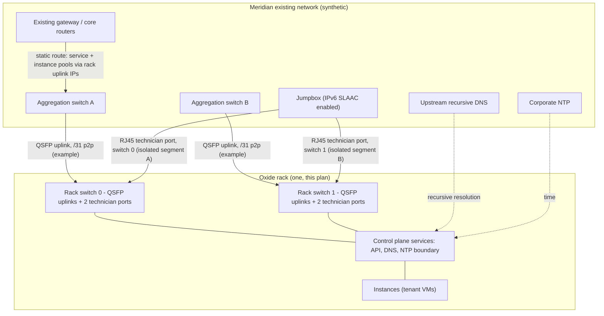

# 02 — Network Integration Plan

> **SYNTHETIC / METHOD DEMONSTRATION — synthetic / 方法演示**
> Meridian's network, VLANs, and addresses are invented. All statements
> about how an Oxide rack connects, routes, and is managed are cited to
> Oxide's public guides. Example addresses follow the documentation-style
> examples used in Oxide's own public guides or RFC documentation ranges.

## 1. Integration points at a glance

| # | Integration point | Oxide side | Customer side (synthetic) |
|---|---|---|---|
| 1 | Data uplinks | Two middle-of-rack switches, QSFP ports (each switch: 32 QSFP ports at 40/100/200 Gbit/s) | Two aggregation switches, one uplink per Oxide switch at first, growing to 2 per switch |
| 2 | Management / setup | Technician ports: 2 RJ45 per switch, 4 total, 10/100/1000BASE-T | Jumpbox on site for setup; later, isolated management segments |
| 3 | Routing | Rack switches operate as **Layer 3 routers**, not L2 switches | Static routes at first; BGP as designed option (Section 4) |
| 4 | DNS | Rack-hosted DNS servers under a delegated zone | Parent zone delegates `cloud.meridian.example` (synthetic) to the rack |
| 5 | Time / resolvers | Rack consumes upstream DNS (recursive resolvers, IP only, max 3) and NTP (max 3) | Existing corporate resolvers and NTP |
| 6 | Identity-adjacent | Silo DNS names under `$silo.sys.<zone>`; API reachable via service IP pool | Corporate DNS + SAML IdP (Section 04) |
| 7 | Firewall | Management and data firewall rules are a planning item in Oxide's guide | Existing perimeter/aggregation ACL process |

Sources for the table: https://docs.oxide.computer/guides/system/network-preparations
(two switches, port counts and speeds, technician ports, checklist of
DNS/NTP/zone/pools/uplink addresses, firewall rules as a planning item)
and https://oxide.computer/product/specifications (minimum two physical
links to the local network).

## 2. Topology



ASCII fallback (same topology):

```text
                 Meridian core / gateway routers
                    |                       |
            Aggregation A             Aggregation B
                    | QSFP /31                | QSFP /31
              +-----v------+            +-----v------+
              |  switch 0  |            |  switch 1  |   Oxide rack
              +-----+------+            +-----+------+
                    +---- control plane / instances ----+
   Jumpbox --RJ45--> tech port SW0 (segment A, isolated)
   Jumpbox --RJ45--> tech port SW1 (segment B, isolated, separate VLAN)
   DNS delegation: cloud.meridian.example -> rack DNS (in service pool)
```

Design notes a data-center / network reviewer will check first:

- **The rack switches are L3 routers; there is no shared broadcast
  domain between ports.** Each active port needs an egress route;
  upstream routes for service and instance prefixes must point at the
  rack-side uplink address as next hop, because the rack does not answer
  ARP/NDP for pool addresses — it answers for the uplink address.
  Source: https://docs.oxide.computer/guides/system/network-preparations
- **Uplink subnets are not pools.** The guide's examples use dedicated
  /31 point-to-point subnets per uplink; uplink ranges must not be
  reused inside an IP pool or routing conflicts result (same source).
- **MTU:** upstream ports facing the rack must be configured with MTU
  1500 or above; if jumbo frames are planned for instances, at least
  9000 (same source).
- **Transceivers:** typically 2–4 per switch (4–8 total) are sufficient
  for uplink redundancy per the guide; the chosen type dictates fiber
  type, connector, and strand count, and must match the fiber plant
  delivered in Section 01 (same source). This plan starts at 1 uplink
  per switch (the documented minimum topology) and pre-cables the
  second pair so growth does not need a new facilities visit — a
  synthetic design decision, labelled as such.

## 3. Management network: technician ports (the easy place to fail)

Oxide's guides are unusually explicit here, and this plan follows them
verbatim in structure:

- Technician ports provide access to `wicket` (the terminal UI used to
  give the rack its initial configuration, bring it online, and perform
  out-of-band updates) and to a support shell for low-level
  troubleshooting; both are reached over SSH, TCP port 22, which must be
  permitted by firewall rules.
- Each switch has two technician ports. During setup you need at least
  one connection per switch, and **the two connections must be isolated
  from each other at the network level** — if they land on the same
  upstream switch they must be on separate VLANs. The documented failure
  mode for skipping this: both switches advertise IPv6 on the same
  broadcast domain, causing discovery of only one switch, race
  conditions in initialization, and failures such as "cannot reach
  scrimlet on switch1".
- Technician-port addressing is by IPv6 SLAAC (periodic advertisements
  every 30 seconds, per the guide) or DHCPv6, each port advertising a
  distinct /64.

Sources: https://docs.oxide.computer/guides/system/network-preparations
and https://docs.oxide.computer/guides/system/rack-installation

Plan commitments: two separate VLANs are requested from the network
team as a *pre-install* deliverable with a named owner; install day does
not start until the isolation is demonstrated (Section 03 gate G2).

## 4. Routing design: static first, BGP as the designed second step

**Phase-in choice (synthetic decision, documented rationale):** start
with the basic integration topology Oxide documents — both rack
switches connected toward a single gateway path, static routes on the
rack toward the default gateway and on the customer routers toward the
rack, an IP pool created for the control plane, and BFD used for
high-availability behaviour so traffic can redirect to the surviving
switch if one switch is down for failure or maintenance.
Source: https://docs.oxide.computer/guides/architecture/networking

**BGP option, designed now, enabled later:** Oxide's routing daemon
(Maghemite) implements DDM for the underlay and also BGP, static, and
OSPF for interconnection with customer networks (same source). The
public operator guides document, step by step, adding BGP on switch
ports (addresses, peer configuration, timers) and expanding
connectivity with additional addressed/VLAN-tagged peerings.
Sources: https://docs.oxide.computer/guides/operator/configuring-bgp
and https://docs.oxide.computer/guides/operator/expanding-connectivity

Constraints recorded for the design review (from Network Preparations):
the rack switches can currently import approximately 1,000 routes —
**full Internet tables are not supported** — so any BGP design must
aggregate/filter at the customer border; IPv6-only external networking
is a supported configuration shape.
Source: https://docs.oxide.computer/guides/system/network-preparations

Decision gate: BGP is enabled only after the static topology has run
the pilot (Section 03) and the network team signs the route-policy
review. Nothing in the pilot depends on BGP.

## 5. Names, numbers, and pools (the pre-work checklist)

Oxide's Network Preparations guide lists exactly what must be gathered
before rack setup; this plan turns it into assigned pre-work:

| Item (per the public guide) | Synthetic example value | Owner |
|---|---|---|
| Upstream DNS servers (max 3, recursive, IP only) | Meridian's two existing resolvers | Network eng. |
| NTP servers (max 3; IP or DNS name) | Existing corporate NTP | Network eng. |
| DNS zone to delegate | `cloud.meridian.example` (synthetic) | Architecture |
| External DNS IPs (at least 2, inside the service pool) | First two addresses of the service pool | Architecture |
| Service IP pool (min 13, recommended 20 addresses; guide also recommends at least 16 for HA, itemized as 5 DNS / 3 API / 2 boundary NTP) | 20-address block (synthetic range) | Architecture |
| Instance IP pools | Sized per onboarded team; can start small and add ranges later (Completing Rack Configuration guide) | Platform team |
| Uplink IPs (one per uplink) + gateway/next hop or BGP peer + ASN | /31 per uplink (Section 2) | Network eng. |
| Transceiver type from the supported list | Matched to Hall B fiber plant | Facilities + Network |

Sources: https://docs.oxide.computer/guides/system/network-preparations
and https://docs.oxide.computer/guides/system/completing-rack-config
(the latter also notes each instance consumes a quarter of an external
IP from the silo's default pool for outbound NAT when sizing pools —
100 VMs need 125 addresses in its worked example; used here as a sizing
rule of thumb from the vendor's own guide, not as a benchmark).

All of the above is frozen into the reviewed `rack.toml` before install
day (Section 03), including the `allowed_source_ips` decision: the
Initial Rack Setup example shows the source-IP allowlist for API/console
access can be "any" or a restricted list of subnets; this plan's default
is **restricted list** (corporate ranges only), recorded as a security
decision for the CISO review.
Source: https://docs.oxide.computer/guides/system/initial-rack-setup

## 6. Firewall / ACL request summary (for the security review)

- Management segments: TCP 22 to technician-port segments from the
  jumpbox segment only.
- Data plane: service-pool addresses reachable from corporate user/VPN
  ranges (API, console, DNS); instance pools per each team's existing
  segmentation policy.
- Rack egress to upstream DNS and NTP only as configured.
- No inbound Internet exposure in this plan; any future change goes
  through the same review that produced this table.
